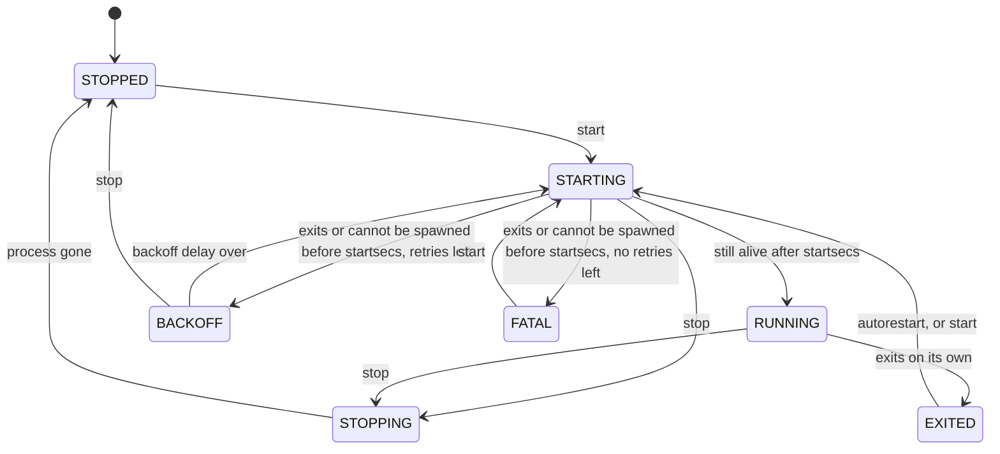
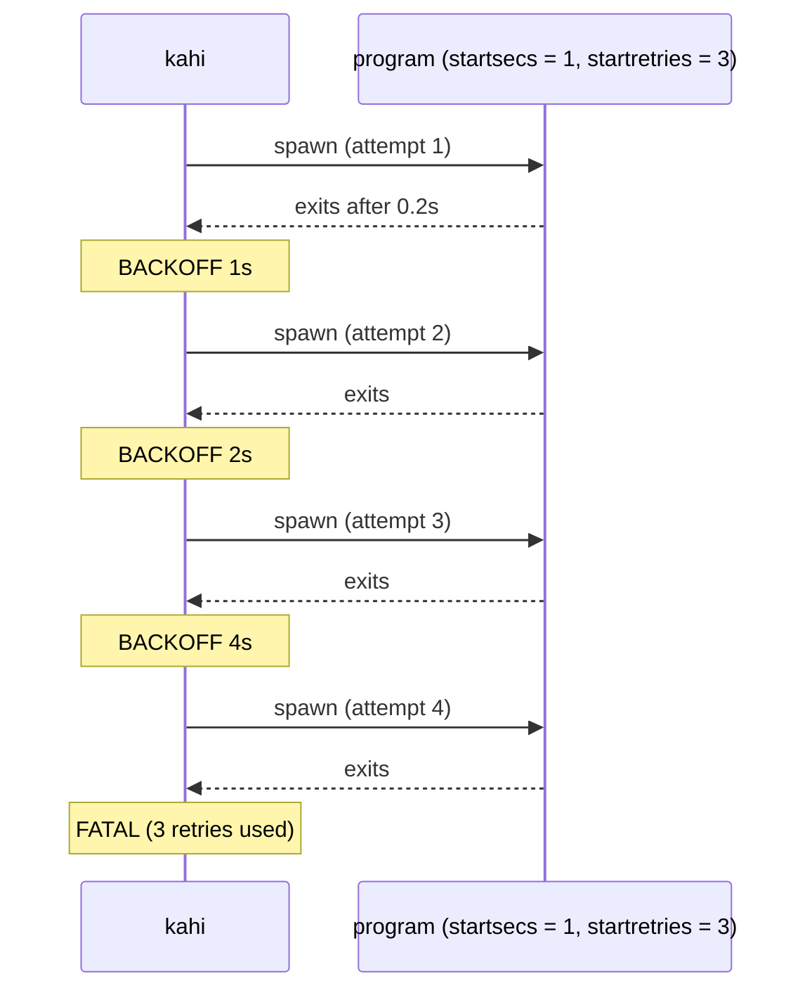
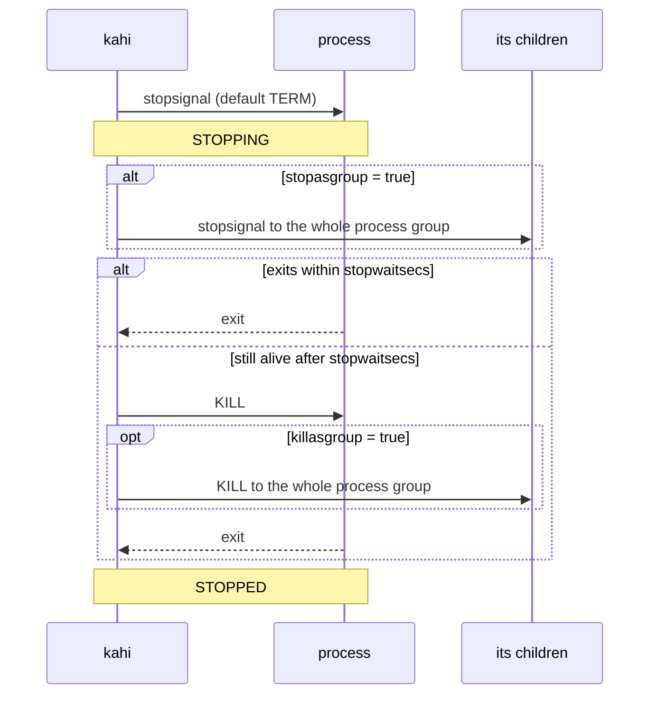
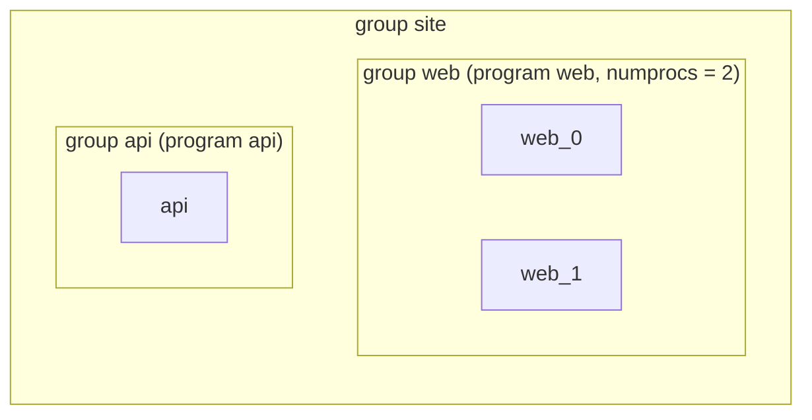

# Process lifecycle and groups

How Kahi starts, watches, restarts and stops a program, and how groups and
priorities order those actions. Every rule on this page is checked by an
end-to-end test against the `kahi` binary; the test names are listed so you can
read the exact behaviour.

## States

A process is always in one of seven states. `kahi ctl status` and
`GET /api/v1/processes` show it; each change is published as a
`PROCESS_STATE_<STATE>` event.



| State    | Meaning                                                                                    |
| -------- | ------------------------------------------------------------------------------------------ |
| STOPPED  | Not running and not meant to be: never started, or stopped on request.                     |
| STARTING | Spawned, not yet alive for `startsecs`.                                                    |
| RUNNING  | Alive for at least `startsecs`. With `startsecs = 0` a spawned process is RUNNING at once. |
| BACKOFF  | Failed to start; waiting before the next attempt.                                          |
| STOPPING | Stop signal sent; waiting for the process to go.                                           |
| EXITED   | Exited by itself after reaching RUNNING. Status shows `exit <code>`.                       |
| FATAL    | Gave up after `startretries` retries. Status shows why when it could not be spawned.       |

## Starting

A start spawns the command directly, without a shell: `command` is split on
whitespace, so `;`, `*` or `$VAR` are passed on literally. Wrap shell logic in
a script. Each child gets its own process group, and these variables on top of
its environment (with `clean_environment = true`, only these and the
configured `environment`):

- `SUPERVISOR_ENABLED=1`
- `SUPERVISOR_PROCESS_NAME=<process name>`
- `SUPERVISOR_GROUP_NAME=<group name>`

Before each spawn Kahi checks the working `directory` and opens the log files.
If that fails, or the command cannot be executed, the attempt counts as a
failed start and status shows the reason, for example
`spawn error: /usr/bin/nope: no such file or directory`,
`spawn error: directory /srv/app does not exist` or
`cannot open log file for web: /var/log/web.log: ...`. Every attempt checks
again, so a program starts once the problem is fixed.

Starting a process that is STARTING, RUNNING or in BACKOFF is an error,
`process already started: <name>` (HTTP 409).

## Retries and backoff

A process that exits, or cannot be spawned, before `startsecs` has passed goes
to BACKOFF and is tried again. The delay doubles: 1s, 2s, 4s, 8s, 16s, 32s, and
then stays at 60s. After `startretries` retries, that is `startretries + 1`
attempts in all, it goes to FATAL and stays there until started again.
`startretries = 0` means FATAL on the first failure.

Reaching RUNNING resets the retry count. A program that runs, crashes after
`startsecs` and is restarted by autorestart gets the full `startretries` again.

`autorestart` plays no part before RUNNING: a program that never gets past
`startsecs` is governed by `startretries` alone, also with
`autorestart = "true"`.



## Autorestart

When a RUNNING process exits by itself it becomes EXITED, and `autorestart`
decides what follows:

| `autorestart`            | Restarted when                                      |
| ------------------------ | --------------------------------------------------- |
| `true`                   | it exits with any code                              |
| `"unexpected"` (default) | its exit code is not in `exitcodes` (default `[0]`) |
| `false`                  | never                                               |

`autorestart` accepts the TOML booleans and the strings `"true"`, `"false"` and
`"unexpected"`. A process stopped on request is never restarted, and nothing is
restarted or retried once daemon shutdown has begun.

## Stopping



- The stop signal goes to the process only, unless `stopasgroup = true` sends
  it to its process group. Without it, children the process started outlive it
  unless it stops them itself.
- `stopwaitsecs` (default 10, at least 1) is how long Kahi waits before KILL.
  `killasgroup = true` sends that KILL to the whole group.
- `stopasgroup = true` requires `killasgroup = true`; the opposite is allowed.
- A process that exits on its own while STOPPING ends STOPPED, not EXITED: the
  stop was requested, so the exit completes it.
- A second stop while STOPPING is ignored. Stopping a process that is not
  running is an error, `process not running: <name>`; stopping one in BACKOFF
  cancels the retry and leaves it STOPPED.

Because every child has its own process group, a signal sent to Kahi's group
(a Ctrl-C in the terminal) does not reach the children; Kahi stops them itself.

## Groups

Every program forms a group of the same name that holds its `numprocs`
instances. `[groups.<name>]` combines programs into another group:

```toml
[groups.site]
programs = ["web", "api"]
```



`kahi ctl start site:*`, `stop site:*` and `restart site:*` act on a group;
the API offers `POST /api/v1/groups/{name}/{start,stop,restart}`.

## Order and priority

Every ordered action uses one key: lower starts first and stops last.

1. The `priority` of the program's `[groups]` table, if it is in one; else the
   program's own `priority`. Both are 0-999 and default to 999.
2. The program's own `priority`.
3. The process name.

So a group orders its members as a block, as in supervisord:

```toml
[programs.solo]
priority = 5

[programs.m1]
priority = 900

[programs.m2]
priority = 800

[groups.g]
programs = ["m1", "m2"]
priority = 1
```

starts `m2`, `m1`, `solo` and stops `solo`, `m1`, `m2`.

| Action                                      | Order                                 | Waits between processes                                                 |
| ------------------------------------------- | ------------------------------------- | ----------------------------------------------------------------------- |
| Daemon start (`autostart = true` programs)  | ascending                             | No: spawns one after the other without waiting for RUNNING              |
| `ctl start <group>:*`, group start          | ascending                             | No                                                                      |
| `ctl stop <group>:*`, group stop            | descending                            | No: signals one after the other                                         |
| Daemon shutdown                             | descending                            | No: signals all, then waits up to `shutdown_timeout` and KILLs the rest |
| `POST /api/v1/all/start` (Web UI Start All) | ascending                             | No; includes `autostart = false` programs                               |
| `POST /api/v1/all/stop` (Web UI Stop All)   | descending                            | Yes: each is stopped (up to `stopwaitsecs` + 5s) before the next        |
| `POST /api/v1/all/restart`                  | stop descending, then start ascending | As stop, then start; a process whose stop failed is not started         |

Waiting for each priority level during daemon shutdown is planned for 0.3.0
([#151](https://github.com/kahiteam/kahi/issues/151)).

The bulk actions skip what needs nothing: a start skips STARTING, RUNNING and
BACKOFF processes and reports STOPPING ones as an error; a stop skips STOPPED,
EXITED and FATAL ones. Each process gets its own `ok`, `skipped` or `error`
entry in the result.

## Readiness

`GET /readyz` (no credentials needed) is 200 when every `autostart = true`
process, or every process named in `?process=a,b`, is RUNNING. Otherwise it is
503 and lists the others:

```json
{ "status": "not_ready", "pending": ["api"], "failing": ["worker"] }
```

`pending` holds STARTING and BACKOFF processes, which may still come up;
`failing` holds every other state. A FATAL program therefore fails the probe
until it is fixed and started again.

## Where this is tested

| Behaviour                                           | e2e tests (`e2e/`)                                                                                                                     |
| --------------------------------------------------- | -------------------------------------------------------------------------------------------------------------------------------------- |
| startsecs, retries, backoff delays and the 60s cap  | `TestLifecycle_StartsecsLowerBound`, `_RetriesToFatal`, `_RetryCountResetsAfterRunning`, `_BackoffDelaysDouble`, `_BackoffCappedAt60s` |
| autorestart                                         | `TestLifecycle_AutorestartAfterRunning`, `_NoRespawnAfterStop`, `_NoRespawnDuringShutdown`, `TestState_AutorestartBool`                |
| spawn: no shell, process group, environment, errors | `TestLifecycle_ExecWithoutShell`, `_SupervisorEnv`, `_SpawnErrors`, `_StartErrorText`, `TestLog_UnwritableLogfileFatal`                |
| stopping, stop signals, process groups              | `TestLifecycle_StoppingVisible`, `_ExitDuringStoppingIsStopped`, `_StopSignalDelivered`, `_StopAsGroup`, `TestProcess_StopWaitSecs`    |
| order and bulk actions                              | `TestBulk_Order`, `TestGroups_PriorityOrdersMembers`, `TestBulk_StartPerState`, `TestBulk_StopPerState`                                |
| readiness                                           | `TestReadyz_States`, `TestReadyz_FatalAutostartNotReady`                                                                               |
